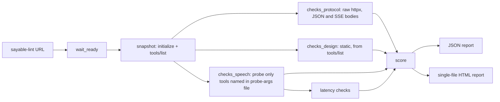

# Checks and scoring

## Flow

Safety rule: the linter only ever calls tools named in the probe-args file. Those entries are chosen by a human, read-only tools only for third-party servers.

## Scoring

Each finding has a `severity`: pass = 1, warn = 0.5, fail = 0.

- Per category: `category_score = round(MAX * earned / count)`. An empty category scores 0.
- `CATEGORY_MAX`: protocol 30, latency 15, speech 35, design 20. `total` is the sum (0-100).
- `spec_score = round(100 * protocol_score / 30)`. Protocol checks are `kind="spec"`.
- `heuristic_score = round(100 * (latency + speech + design) / 70)`. These are `kind="heuristic"`.

Spec and heuristic scores are always reported separately. Heuristics are configurable and are labelled as such.

## Check catalogue

### Protocol (kind = spec)

| ID | Check |
|---|---|
| PROTO-01 | initialize succeeds and protocol >= 2025-11-25 |
| PROTO-02 | bad `MCP-Protocol-Version` header returns 400 |
| PROTO-03 | `notifications/initialized` returns 202 |
| PROTO-04 | bad `Origin` returns 403 |
| PROTO-05 | GET returns 405 or `text/event-stream` |
| PROTO-06 | bogus `Mcp-Session-Id` returns 404 (pass as stateless if no session issued) |
| PROTO-07 | `tools/list` entries are schema-valid |
| PROTO-08 | unknown method returns JSON-RPC -32601, not HTTP 500 |
| PROTO-09 | a 401 advertises OAuth protected-resource discovery (pass/warn only; pass if no auth required) |

Every POST sends `Accept: application/json, text/event-stream`; the parser handles both JSON and SSE bodies.

### Speech (kind = heuristic)

| ID | Check |
|---|---|
| SPEECH-00 | warn when no probe args were given |
| SPEECH-01 | word count <= `--max-words` (default 45) |
| SPEECH-02 | no markdown or table characters |
| SPEECH-03 | no URL, ISO timestamp or UUID |
| SPEECH-04 | text is not raw JSON |
| SPEECH-05 | no emoji |
| SPEECH-06 | `structuredContent` present and valid against any declared outputSchema |
| SPEECH-07 | error replies <= 25 words with no traceback |

### Latency (kind = heuristic)

| ID | Check |
|---|---|
| LAT-01 | initialize <= 1500 ms |
| LAT-02 | tools/list <= 500 ms |
| LAT-03 | per-tool p95 <= `--latency-ms` (default 800) |

### Design (kind = heuristic)

| ID | Check |
|---|---|
| DES-01 | `readOnlyHint` and `destructiveHint` set explicitly |
| DES-02 | non-read-only tools have a `confirm*` parameter |
| DES-03 | description length 20-300 characters |
| DES-04 | no description pair has word-Jaccard >= 0.5 |
| DES-05 | <= 15 tools |
| DES-06 | <= 3 required parameters per tool |

